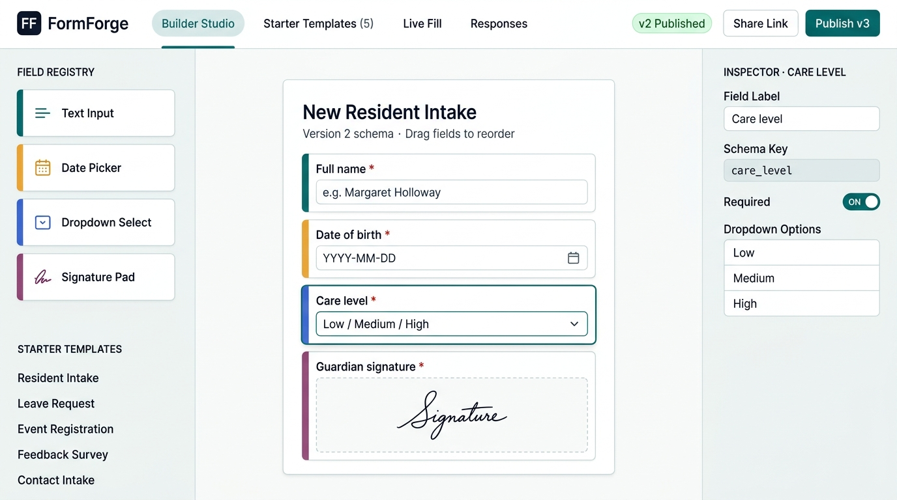
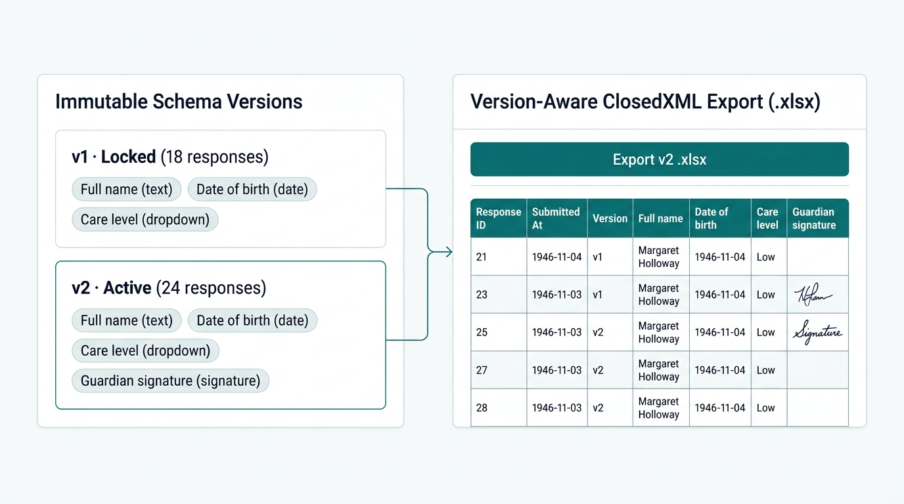
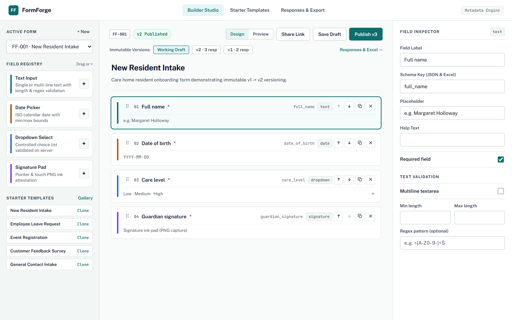
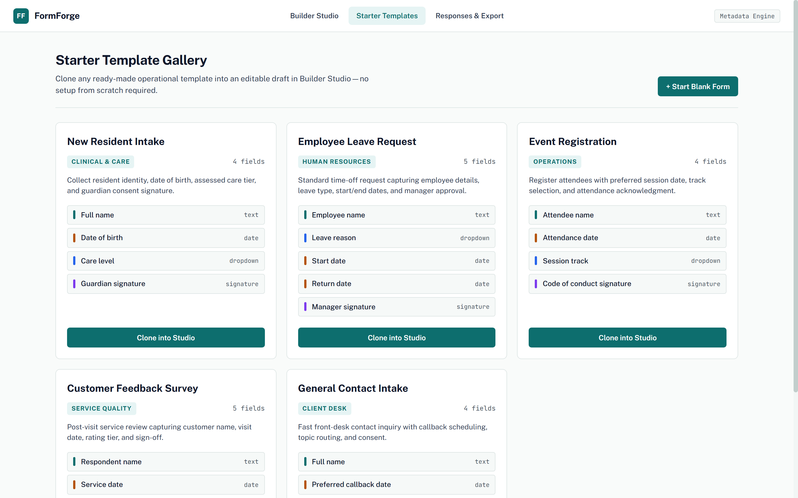
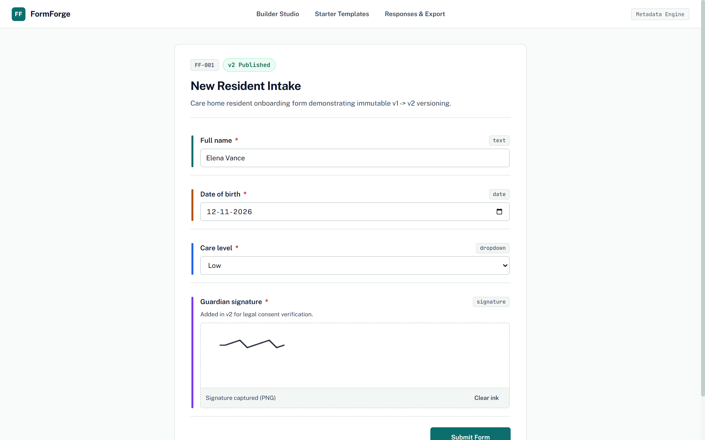
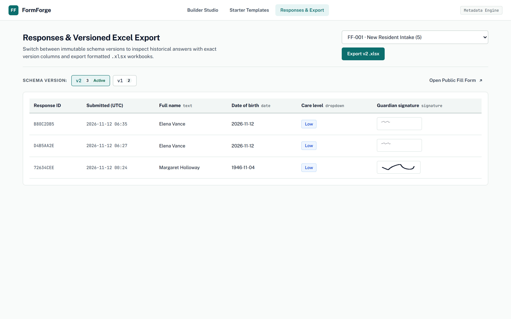

# FormForge — Metadata-Driven Form Studio

A low-code, metadata-driven form builder and collection engine built with **Angular 19** (Reactive Forms + Angular CDK Drag-and-Drop), **ASP.NET Core 8 Web API**, **SQL Server (JSON Schema & Response Storage)**, and **ClosedXML** for version-accurate `.xlsx` workbook export.

---

## Visual Overview & UI Mockups

### Design Concept Mockups

| 3-Pane Form Studio Concept | Immutable Versioning & Excel Export |
|---|---|
|  |  |

### Running Application Screenshots

#### Builder Studio (`/studio`) — CDK Drag-and-Drop + Immutable Versions


#### Starter Template Gallery (`/templates`) — 5 Operational Templates


#### Public Fill View (`/fill/:slug`) — Runtime Dynamic Form + Canvas Signature Capture


#### Responses & Versioned Excel Export (`/responses`) — Dynamic Columns & Embedded Signatures


---

## Core Architecture

### 1. Reusable Field-Type Registry
Adding a new field type does not require touching existing saved forms or published schemas:
- **Backend (`backend/FormForge.Api/FieldRegistry/`):** Implement [`IFieldTypeHandler`](backend/FormForge.Api/FieldRegistry/IFieldTypeHandler.cs) (`Descriptor`, `ValidateFieldDefinition`, `TryValidateAnswer`, `FormatCellText`) and register it in [`Program.cs`](backend/FormForge.Api/Program.cs). Built-in handlers (`FieldTypeHandlers.cs`):
  - `text` (`TextFieldHandler`): Single-line or multiline text, min/max length, regex pattern validation.
  - `date` (`DateFieldHandler`): ISO `YYYY-MM-DD` date parsing with optional `minDate` / `maxDate` bounds.
  - `dropdown` (`DropdownFieldHandler`): Controlled option list strictly checked against schema options on the server.
  - `signature` (`SignatureFieldHandler`): Pointer/touch HTML5 `<canvas>` PNG data URI validated for base64 integrity, PNG magic header bytes, and size limits (`<= 512 KB`).
- **Frontend (`frontend/src/app/`):**
  - [`field-registry.ts`](frontend/src/app/core/registry/field-registry.ts): Field metadata catalog and 4px left-edge binder tab accents (`#0d6e6e`, `#b45309`, `#2563eb`, `#7c3aed`).
  - [`dynamic-form-renderer.component.ts`](frontend/src/app/shared/dynamic-form-renderer/dynamic-form-renderer.component.ts): Compiles any `FormSchema` into an Angular `FormGroup` with synchronized validators and field components (`text-field`, `date-field`, `dropdown-field`, `signature-field`).

### 2. Immutable Form Versioning & SQL Server Storage
Instead of mutating database columns per form, FormForge stores schema drafts and immutable published snapshots as JSON inside SQL Server (`(localdb)\MSSQLLocalDB` by default):

```text
Forms (FormEntity)
 ├── Id, CatalogCode (e.g. FF-001), Slug, Title, Description
 ├── CurrentDraftJson          <-- Editable working draft JSON
 └── ActiveVersionId ──────────┐
                               ▼
FormVersions (FormVersionEntity)
 ├── Id, FormId, VersionNumber (v1, v2, ...), IsPublished, PublishedAt
 └── SchemaJson                <-- Immutable snapshot frozen at publish time
                               ▲
FormResponses (FormResponseEntity)
 ├── Id, FormId, FormVersionId (DeleteBehavior.Restrict)
 └── AnswersJson, SubmittedAt  <-- Permanently bound to the exact FormVersionId
```

- Publishing changes creates `v2`, `v3`, ... without altering `v1`.
- Responses collected on `v1` stay bound to `v1`'s exact columns, so filtering responses or exporting `.xlsx` in `v1` vs `v2` always matches the schema active when the respondent submitted.

### 3. Starter-Template Gallery
Rather than requiring external AI API keys, FormForge ships 5 ready-to-clone operational templates in [`StarterTemplates.cs`](backend/FormForge.Api/Services/StarterTemplates.cs):
1. **New Resident Intake** (`Clinical & Care`)
2. **Employee Leave Request** (`Human Resources`)
3. **Event Registration** (`Operations`)
4. **Customer Feedback Survey** (`Service Quality`)
5. **General Contact Intake** (`Client Desk`)

### 4. Version-Aware Excel Export (`ClosedXML`)
[`ExcelExportService.cs`](backend/FormForge.Api/Services/ExcelExportService.cs) dynamically generates headers from the selected `FormVersion.SchemaJson`:
- Prefixes spreadsheet formula trigger characters (`=`, `+`, `-`, `@`, `\t`, `\r`) with Excel `IncludeQuotePrefix = true` so exported cells are literal text.
- Embeds captured `signature` PNGs directly into `.xlsx` worksheet cells via ClosedXML `AddPicture` and freezes the header row.

---

## REST API Endpoints

| Method | Route | Purpose |
|---|---|---|
| `GET` | `/api/field-types` | List registered field types & metadata descriptors |
| `GET` | `/api/templates` | List the 5 starter templates |
| `POST` | `/api/templates/{key}/clone` | Clone a template into a new editable draft form |
| `GET` | `/api/forms` | List forms with active version & response counts |
| `POST` | `/api/forms` | Create a blank or schema-backed draft form |
| `GET` | `/api/forms/{id}` | Fetch form draft, version history, and response counts |
| `PUT` | `/api/forms/{id}/draft` | Save working draft schema edits |
| `POST` | `/api/forms/{id}/publish` | Snapshot working draft into next immutable `FormVersion` |
| `GET` | `/api/forms/{id}/responses?versionId=` | Fetch version-scoped responses (`Schema` + `Responses`) |
| `GET` | `/api/forms/{id}/export?versionId=` | Download `.xlsx` workbook for the chosen schema version |
| `DELETE` | `/api/forms/{id}` | Delete form and associated drafts/versions/responses |
| `GET` | `/api/public/forms/{slug}` | Fetch active published schema for `/fill/:slug` |
| `POST` | `/api/public/forms/{slug}/responses` | Server-validate and persist a public form submission |

---

## Project Structure

```text
FormForge/
├── backend/
│   ├── FormForge.sln
│   ├── FormForge.Api/          # ASP.NET Core 8 Web API, EF Core SQL Server, Registry, ClosedXML
│   └── FormForge.Tests/        # xUnit unit & WebApplicationFactory integration tests
├── frontend/                   # Angular 19 standalone app + @angular/cdk drag-and-drop
│   ├── proxy.conf.json         # Proxies /api -> http://localhost:5137 in dev
│   └── src/app/
│       ├── core/               # Models, API client, client field registry
│       ├── shared/             # DynamicFormRenderer + field-shell, text, date, dropdown, signature
│       └── pages/              # Builder Studio, Starter Templates, Public Fill, Responses & Export
└── docs/
    ├── mockups/                # Concept & architecture mockups
    └── screenshots/            # Verified application captures
```

---

## Running Locally

### Prerequisites
- [.NET 8 SDK](https://dotnet.microsoft.com/download/dotnet/8.0)
- [Node.js 20+ / 22+](https://nodejs.org/) & npm
- SQL Server LocalDB (`(localdb)\MSSQLLocalDB`) or update `ConnectionStrings:DefaultConnection` in `backend/FormForge.Api/appsettings.json`

### 1. Start the ASP.NET Core 8 API
```powershell
dotnet run --project backend/FormForge.Api --urls http://localhost:5137
```
On first boot, `DbSeeder` creates `FormForgeDb` and seeds **New Resident Intake (`FF-001`)** with `v1` (3 fields, 2 responses) and `v2` (4 fields including guardian PNG signature, 1 response), plus **Employee Leave Request (`FF-002`)**.

### 2. Start the Angular 19 Frontend
```powershell
cd frontend
npm install
npm start
```
Open `http://localhost:4200` (API requests to `/api/*` automatically proxy to `http://localhost:5137`).

### 3. Run Automated Tests & Production Build
```powershell
dotnet test backend/FormForge.sln
cd frontend
npm run build
npx ng test --watch=false --browsers=ChromeHeadless
```
